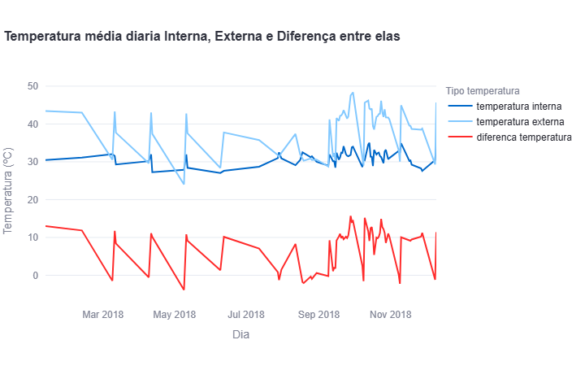
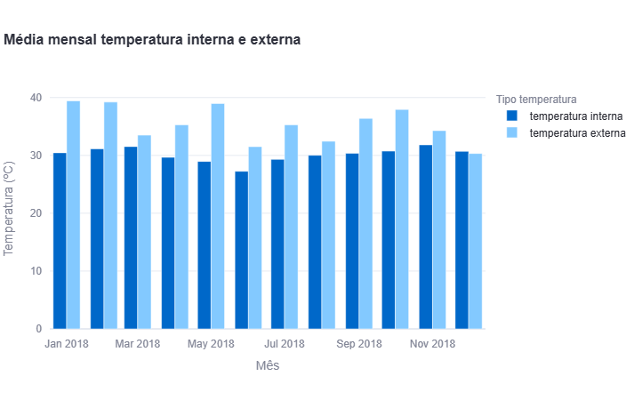
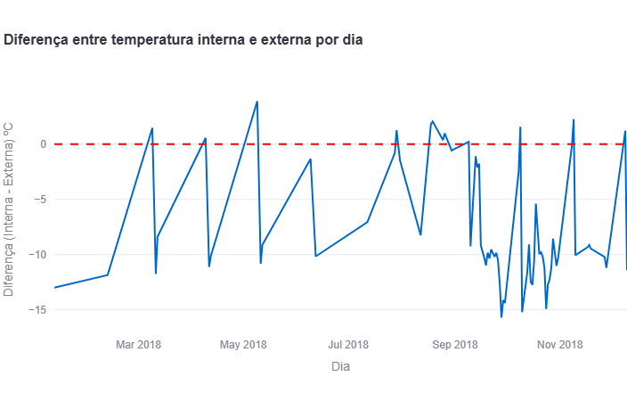

# Trabalho IoT Big Data & IA

Projeto de análise e visualização de dados de temperatura de sensores IoT, com carregamento para banco PostgreSQL e apresentação em dashboard interativo.

## Objetivo

Este projeto coleta dados de temperatura de um arquivo CSV, insere as informações em um banco de dados PostgreSQL, cria views SQL para agregação e exibe indicadores em um dashboard com Streamlit + Plotly.

## Tecnologias

- Python
- Pandas
- SQLAlchemy
- PostgreSQL
- Streamlit
- Plotly
- psycopg2-binary
- Python Dotenv

## Estrutura do projeto

- `src/` – scripts principais da aplicação
  - `main.py` – leitura do CSV, conexão com o banco e criação das views
  - `dashboard.py` – dashboard com gráficos
  - `database/` – funções de conexão e leitura do banco
  - `script_reader/` – leitura do arquivo CSV
  - `views/` – scripts SQL para geração das views
- `data/` – arquivo de dados do projeto
- `infra/` – arquivos de configuração do ambiente, incluindo o `.env`
- `pyproject.toml` – dependências do projeto

## Pré-requisitos

- Python 3.14/3.15
- Poetry
- PostgreSQL configurado e acessível

## Configuração do ambiente

1. Clone o repositório
2. Instale as dependências:

```bash
poetry install
```

3. Crie o arquivo `.env` dentro da pasta `infra/` com as variáveis abaixo:

```env
USER=seu_usuario
SECRET_KEY=sua_senha
URL=localhost
PORT=porta_http
DATABASE=nome_do_banco
```

> O projeto espera encontrar o arquivo `infra/.env` para conexão com o banco.

## Execução

### 1) Criar o container Postgres caso não tenha um postgres configurado

```bash
docker run --name postgres-iot -e POSTGRES_PASSWORD=sua_senha -p 5432:5432 -d postgres
```

Esse comando cria um container PostgreSQL local com nome `postgres-iot`, senha definida em `POSTGRES_PASSWORD` e porta `5432` exposta para a máquina local. Ele é útil quando você ainda não possui um banco PostgreSQL configurado no ambiente de desenvolvimento.

> Caso o banco já esteja em execução localmente, essa etapa pode ser ignorada.

### 2) Carregar os dados no banco

```bash
poetry run python src/main.py
```

Esse comando realiza:

- leitura do arquivo `data/IOT-temp.csv`
  - acessivel em [www.kaggle.com](https://www.kaggle.com/datasets/atulanandjha/temperature-readings-iot-devices)
- conversão de datas
- inserção dos dados no PostgreSQL
- criação das views SQL

### 3) Abrir o dashboard

```bash
poetry run streamlit run src/dashboard.py
```

O dashboard exibe:

- comparação de temperatura interna e externa
- média mensal
- diferença entre temperaturas por dia

## Observações

- O arquivo de dados pode ser ajustado conforme a sua base de sensores.
- Os scripts SQL em `src/views/` definem as métricas utilizadas no dashboard.
- O projeto usa configuração por variáveis de ambiente em `infra/.env`.

## Gráficos







## Views

### `temp_in_out_diff`

Essa view agrega os dados por dia e calcula a média da temperatura interna e externa para cada data. Ela também retorna a diferença entre os dois valores, permitindo comparar o comportamento diário dos sensores.

- `dia`: data da leitura, agrupada por dia
- `temperatura interna`: média das leituras com `"out/in" = 'In'`
- `temperatura externa`: média das leituras com `"out/in" = 'Out'`
- `diferenca temperatura`: diferença entre as médias interna e externa

### `vw_avg_month`

Essa view agrega os dados por mês e calcula a média mensal da temperatura interna e externa. Ela é útil para identificar tendências e variações sazonais ao longo do tempo.

- `mes`: mês da leitura
- `temperatura interna`: média mensal interna
- `temperatura externa`: média mensal externa


### `diff_in_out_day`

Essa view calcula, por dia, a diferença entre a temperatura interna e a externa. É uma análise mais focada na variação diária da diferença entre os sensores.

- `dia`: data da análise
- `diferenca temperatura`: diferença entre as médias internas e externas no mesmo dia

Seu objetivo é acompanhar como a diferença entre os ambientes se comporta ao longo do tempo, destacando aumentos ou reduções diárias.

## Insights

### Diferença entre temperaturas internas e externas

As medições classificadas como externas apresentaram temperatura média de **36,27 °C**, enquanto as medições internas apresentaram média de **30,45 °C**. Dessa forma, a temperatura externa foi, em média, aproximadamente **5,82 °C superior** à temperatura interna.

Esse comportamento indica que, durante grande parte do período analisado, os ambientes internos apresentaram temperaturas inferiores às condições externas. Em um cenário real, essa diferença poderia ser utilizada para avaliar o comportamento térmico de um ambiente e verificar a eficiência de estratégias de isolamento, ventilação ou climatização.

### Variação ao longo dos meses

A comparação mensal mostrou que a diferença entre as temperaturas internas e externas não permaneceu constante durante o ano.

Em **maio**, por exemplo, a temperatura média externa foi de **38,98 °C**, enquanto a interna foi de **28,95 °C**, resultando em uma diferença de aproximadamente **10,03 °C**.

Já em **dezembro**, as médias ficaram muito próximas: **30,33 °C externamente** e **30,70 °C internamente**. Nesse período, a temperatura interna chegou a ficar aproximadamente **0,37 °C acima** da temperatura externa.

Isso demonstra que a relação entre as temperaturas pode variar significativamente ao longo do período analisado, tornando o acompanhamento contínuo dos sensores importante para identificar alterações no comportamento térmico.

### Dias com maiores diferenças

A análise diária também revelou períodos de grande diferença entre as temperaturas.

Em **28 de setembro de 2018**, a diferença entre a média interna e externa foi de aproximadamente **15,70 °C**, com a temperatura externa significativamente superior à interna.

Outros dias próximos também apresentaram diferenças elevadas, como **10 e 24 de outubro**, com diferenças aproximadas de **15,20 °C** e **14,92 °C**, respectivamente.

Esses eventos podem representar situações de maior variação térmica e seriam interessantes para uma análise mais aprofundada em um sistema real, principalmente para investigar as condições ambientais ou operacionais que provocaram essas diferenças.

### Aplicação em um ambiente real

Em uma aplicação IoT real, esses dados poderiam ser utilizados para criar um sistema de monitoramento automático capaz de acompanhar a temperatura de ambientes e gerar alertas quando determinados limites fossem ultrapassados.

Por exemplo, caso a temperatura externa aumentasse significativamente enquanto a temperatura interna permanecesse estável, o sistema poderia indicar que o ambiente está mantendo suas condições térmicas. Por outro lado, uma aproximação excessiva entre as temperaturas poderia indicar a necessidade de avaliar isolamento, ventilação ou climatização.

Além disso, o armazenamento histórico dessas informações em um banco de dados permitiria comparar períodos diferentes, identificar padrões e auxiliar na tomada de decisões relacionadas ao controle térmico e à eficiência energética.

## Comandos Git utilizados

Os principais comandos Git utilizados durante o desenvolvimento e publicação do projeto foram:

```bash
# Inicializar o repositório local
git init

# Adicionar os arquivos do projeto ao staging
git add .

# Criar um commit com as alterações
git commit -m "Projeto inicial: Pipeline de Dados IoT"

# Adicionar o repositório remoto do GitHub
git remote add origin https://github.com/jonathan-JIPSlok/pipeline-de-dados-IoT.git

# Enviar o projeto para o GitHub
git push -u origin master

# Atualizar o repositório local com alterações do repositório remoto
git pull
```

## Licença

Este projeto foi desenvolvido para fins acadêmicos e de estudo.
